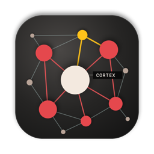

<p align="center"></p>

<h1 align="center">Cortex</h1>

<p align="center"><b>A second brain for your AI.</b><br>
Your memories as plain Markdown files, shown as a living neural network, and available inside Claude, ChatGPT, Cursor and other AI apps.</p>

<p align="center"><a href="https://github.com/leesummerdesigns/cortex/releases/latest/download/Cortex.zip"><b>Download for Mac</b></a> · macOS 15 or later · Apple Silicon and Intel · free and open source</p>

---

Every AI chat starts from zero. Cortex gives your AI a memory that you own: a folder of Markdown notes on your Mac (an Obsidian vault works as is). Cortex reads it, finds how your notes connect, and lets every AI app you use recall from it.

- **Your files, your Mac.** Notes stay plain `.md` files. Search and connections run on-device with Apple's language models. Nothing leaves your Mac unless you turn on the Bridge.
- **A graph you want to look at.** Every note is a sphere, every link a line, and you can watch pulses travel along them when an AI recalls something. Colors, glow, line shape and more are adjustable.
- **Works inside your AI.** One click connects Claude Desktop, Claude Code, Cursor and Codex through MCP. The Bridge adds Claude and ChatGPT on the web and on your phone.
- **Core memory.** Notes in `00 Core` (who you are, how you want answers) are loaded at the start of every conversation.
- **Personas and packs.** Switch how your AI works with you (finance guide, devil's advocate, language tutor, chief of staff, …) or add knowledge packs. Make your own and share them as a folder.
- **You review what the AI remembers.** When an AI wants to save something, it lands in your inbox as a proposal. Accept or discard it in Cortex.
- **Recall theater, timeline, health.** See what your AI just looked up, replay how your memory grew, and find orphaned or stale notes.

## Install

1. [Download Cortex.zip](https://github.com/leesummerdesigns/cortex/releases/latest/download/Cortex.zip), unzip it and move **Cortex** to your Applications folder.
2. Cortex isn't signed with an Apple Developer ID yet, so macOS blocks the first launch. Allow it once, with either option:
   - Open Cortex, close the warning, then go to **System Settings → Privacy & Security** and click **Open Anyway**.
   - Or run this in Terminal:
     ```bash
     xattr -dr com.apple.quarantine /Applications/Cortex.app
     ```
3. On first launch Cortex creates `~/Documents/Cortex` with a few starter notes. To use an existing folder (for example your Obsidian vault), click **Change…** under **Connect → Your memory**.

## Connect your AI

Open **Connect** in the sidebar.

| App | How |
|---|---|
| **Claude Desktop** | Click **Connect**, then **Install** in the window Claude opens. |
| **Claude Code** | Click **Connect**. Optionally turn on the session hook so every session starts with your core memory. |
| **Cursor** | Click **Connect**. |
| **Codex** (OpenAI's coding agent: app, CLI, IDE) | Click **Connect**, then start a new Codex session. |
| **Other MCP apps** (Windsurf, VS Code, Zed, …) | Click **Copy config** and paste it into the app's MCP settings. |
| **claude.ai (web, iPhone, Android)** | Turn on the **Bridge**, then add the shown address in claude.ai under **Settings → Connectors → Add custom connector**. Approve the device with the pairing code shown in Cortex. |
| **ChatGPT (web, phone, desktop)** | Turn on the **Bridge**. In ChatGPT: **Settings → Apps → Advanced settings → Developer mode** (Plus, Pro or Business), then **Create app** with the shown address and OAuth. Approve with the pairing code, then pick Cortex in a chat via **+ → Developer mode**. |

Your AI then gets these tools:

| Tool | What it does |
|---|---|
| `get_core` | Loads your core memory and the active persona. |
| `recall` | Searches your memory by meaning and keywords. |
| `read_note` | Reads one note in full. |
| `remember` | Proposes a new memory (you review it in Cortex). |
| `switch_persona` | Switches persona, e.g. when you say "be my editor". |

### About the Bridge

The Bridge makes your memory reachable from other devices while your Mac is awake and Cortex is running. It needs Cloudflare's free tunnel tool:

```bash
brew install cloudflared
```

Each device must be approved with the pairing code shown in Cortex, and you can revoke devices at any time. Two current limits: the address changes when the Bridge restarts (you re-add the connector), and claude.ai shows Cloudflare's cloud icon for the connector because the address is on Cloudflare's shared tunnel domain.

## How your memory is organized

Cortex works with any folder of Markdown files and reads `[[wikilinks]]` like Obsidian.

| Folder or frontmatter | Meaning |
|---|---|
| `00 …` (e.g. `00 Core`) | **Core**: always loaded at the start of a conversation |
| `02 …`, `03 …` (projects, areas) | **Context**: active work, recalled first |
| `01 Inbox` | Where AI proposals land for review |
| everything else | **Memory**: recalled when relevant |
| `layer: core` | Overrides the folder rule for one note |
| `privacy: private` | Never shared with any AI |
| `type: decision` | A decision with its reasoning; listed under Decisions in the sidebar |
| `revisit: 2027-01-15` | Brings the note back in Today on that day |
| `group: Name` | Clusters the note with its group in a coloured sector of the graph (one group per note; set it from the note inspector) |

## Beyond the graph

- **Chat**: ask your memory from inside Cortex. The answer comes from Claude Code or Codex, whichever you're signed in to, on the subscription you already have. It names its sources, what it looks up lights up on the graph, and it can only reach Cortex: no shell, no other files, no private notes. Chats stay out of your notes until you press Save to memory.
- **Today**: a few notes that come back on their own: ones you asked to revisit, and old ones close to what you're working on now.
- **Quick Capture**: press ⌃⌥N in any app (or ⌘N in Cortex). Related notes and a likely folder appear as you type.
- **Decisions**: log what you decided, why, and when to look at it again. AI tools can propose decisions too.
- **Tasks**: every open `- [ ]` in your vault in one list, without setup. Ticking one ticks it in its note. Add `📅 2026-12-01` to give it a date.
- **What your AI actually uses**: the Health panel shows which notes AI tools really read, and which they never touch.

## Packs and personas

A pack is a folder with a `pack.json` and some Markdown notes. A **persona** pack changes how the AI works with you and joins your core while it's active; a **knowledge** pack adds notes to recall. Install, export and share packs from the **Packs** panel. Cortex ships with these starter packs in [`Packs/`](Packs):

| Persona | How your AI works with you |
|---|---|
| **Finance Guide** | Budgets, saving, debt and investing basics. Shows the math, names fees and risks, no hot tips. |
| **Devil's Advocate** | Stress-tests plans: steelman, weakest assumption, pre-mortem, then a decision. |
| **Language Tutor** | Conversation practice with gentle corrections; remembers your recurring mistakes. |
| **Chief of Staff** | Priorities, decisions and ready-to-send drafts; tracks what you committed to. |
| **Research Analyst** | Evidence first: confidence levels, graded sources, no invented citations. |
| **Patient Teacher** | Explains anything step by step, with examples from your own projects. |
| **Socratic Coach** | Asks sharp questions so you reach your own answer. |
| **Ruthless Editor** | Cuts fluff and sharpens the argument while keeping your voice. |
| **Senior Engineer** | Pragmatic, test-first, minimal diffs; pushes back on overengineering. |

| Knowledge pack | What it adds |
|---|---|
| **Product Strategy** | Jobs to be Done, Aggregation Theory, North Star Metric, pricing models |
| **Context Engineering** | How to write memories and context that AI uses well |
| **SwiftUI Modern** | Current SwiftUI, Observation and SwiftData practice |

```json
{
  "id": "socratic-coach",
  "name": "Socratic Coach",
  "author": "Cortex",
  "version": "1.0",
  "kind": "persona",
  "color": "#6cc3a0",
  "description": "Helps you think instead of thinking for you."
}
```

## Command line

The app bundles a helper at `Cortex.app/Contents/Helpers/cortex`:

```
cortex mcp [vault]            MCP server on stdio
cortex core [vault]           core memory as Markdown
cortex recall "query" [vault] search your memory
cortex stats [vault]          note and link counts
cortex serve [vault] [port]   Bridge server (MCP over HTTP with OAuth)
```

## Build from source

Requires Xcode 16 or later (Swift 6) and Node.js.

```bash
git clone https://github.com/leesummerdesigns/cortex.git
```

```bash
cd cortex && scripts/build-app.sh
```

The app is written to `build/Cortex.app`. Run the tests with `swift test`.

The project has three parts: `CortexKit` (vault parsing, embeddings, recall, packs, connections), `CortexApp` (the SwiftUI app) and `CortexCLI` (the `cortex` helper with the MCP server and the Bridge). The graph is a three.js page in [`web/`](web) shown in a web view.

## Creator

Designed and built by [Louis Henrich](https://louishenrich.com/pages/about.html), an AI consultant and product designer based in Zurich, Switzerland.

The [Cortex case study](https://louishenrich.com/pages/cortex.html) explains the product decisions, interaction design and implementation.

## License

[MIT](LICENSE)
